# OneDestiny — Complete Application Architecture, User Flows & Screen Documentation

> **Application**: OneDestiny Customer Mobile & Web App  
> **Brand Tagline**: *"Make Every Celebration in One Place"*  
> **Version**: `V 04.11.26` (Build 28)  
> **Release Date**: 4 November 2026  
> **Engineering Organization**: Ekame Technologies  
> **Development Team**:  
> - **Manohar** — Developer  
> - **Datta** — Developer  

---

## Table of Contents
1. [Executive Summary & Brand Identity](#1-executive-summary--brand-identity)
2. [Engineering Architecture & Tech Stack](#2-engineering-architecture--tech-stack)
3. [The 10 Canonical UI States Architecture](#3-the-10-canonical-ui-states-architecture)
4. [Application User Flows](#4-application-user-flows)
   - [4.1 Onboarding & Authentication Flow](#41-onboarding--authentication-flow)
   - [4.2 Marketplace Discovery & Search Flow](#42-marketplace-discovery--search-flow)
   - [4.3 Vendor Selection & Booking Flow](#43-vendor-selection--booking-flow)
   - [4.4 Vendor Communication & Concierge Flow](#44-vendor-communication--concierge-flow)
   - [4.5 Profile, Sessions & Device Security Flow](#45-profile-sessions--device-security-flow)
5. [Screen-by-Screen Visual Walkthrough](#5-screen-by-screen-visual-walkthrough)
   - [5.1 Splash Screen (Brand Identity)](#51-splash-screen-brand-identity)
   - [5.2 Authentication & Login (OTP & Password)](#52-authentication--login-otp--password)
   - [5.3 Marketplace Home Screen](#53-marketplace-home-screen)
   - [5.4 Explore Vendors Directory](#54-explore-vendors-directory)
   - [5.5 Bookings & Event Requests Management](#55-bookings--event-requests-management)
   - [5.6 Real-Time Chat & Vendor Messaging](#56-real-time-chat--vendor-messaging)
   - [5.7 Customer Profile & Account Management](#57-customer-profile--account-management)
   - [5.8 About OneDestiny & Development Team Credits](#58-about-onedestiny--development-team-credits)
   - [5.9 Vendor & Venue Detail Screen](#59-vendor--venue-detail-screen)
   - [5.10 Saved Favorites Collection](#510-saved-favorites-collection)
   - [5.11 24/7 Event Concierge & Help Policies](#511-247-event-concierge--help-policies)
   - [5.12 Dark Theme Experience](#512-dark-theme-experience)
6. [Data Models & API Contracts](#6-data-models--api-contracts)
7. [Verification & Build Commands](#7-verification--build-commands)

---

## 1. Executive Summary & Brand Identity

**OneDestiny** is an ultra-luxury digital marketplace designed to bridge celebration planners with elite event vendors, premium wedding planners, convention venues, photographers, caterers, decorators, and entertainment specialists.

### Brand Visual Identity
- **Primary Color Palette**:
  - **Imperial Deep Burgundy** (`#6B1028` to `#160207`): Evokes royalty, grandeur, and celebration.
  - **Champagne Gold** (`#D4AF37` / `#E5B246`): Accents, metallic typography, and borders.
  - **Warm Ivory / Cream** (`#FFFDF9`): Light mode card and background surfaces.
  - **Obsidian Dark Surface** (`#121212`): Dark mode card and background surfaces.
- **Brand Emblem**:
  - Interlocking 3D beveled infinity rings with an ascending diagonal ribbon.
  - Center 4-point radiant celebration star.
  - Classic serif namemark: **ONE DESTINY**.
  - Symmetrical luxury tagline: **—— MAKE EVERY CELEBRATION IN ONE PLACE ——**.

---

## 2. Engineering Architecture & Tech Stack

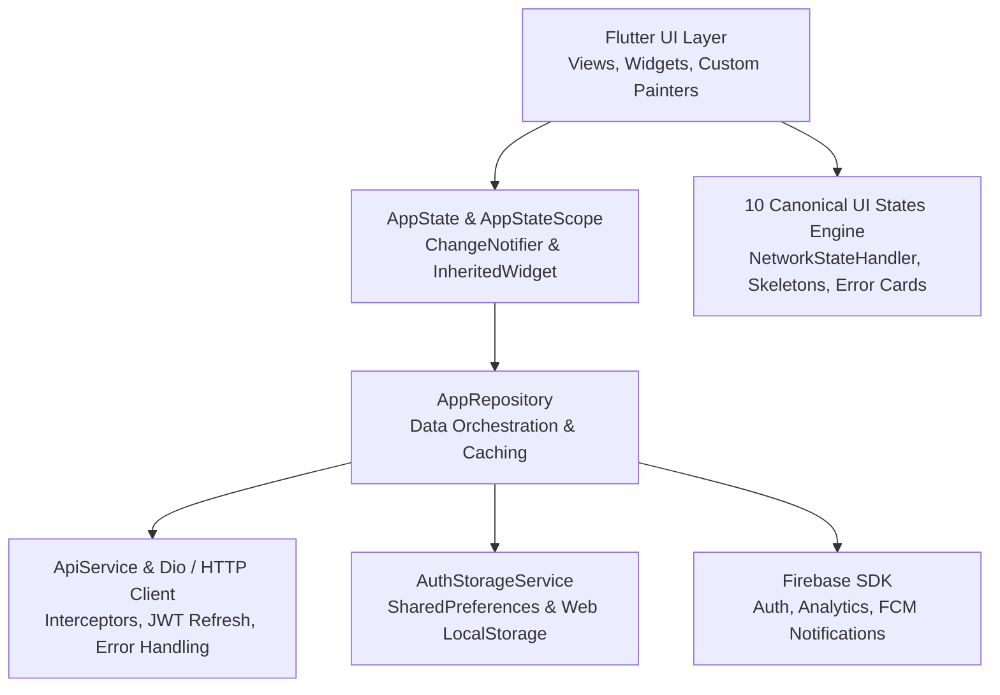

### Core Technologies
- **Framework**: Flutter SDK (Channel stable, Multiplatform: Web, Android, iOS, Windows/macOS)
- **Language**: Dart 3.x
- **State Management**: Reactive `AppState` via `AppStateScope` (InheritedWidget + ChangeNotifier)
- **Networking**: REST API client with automatic token attachment, JWT rotation, and unified `ApiResponse<T>` envelope
- **Persistent Storage**: `AuthStorageService` with cross-platform secure storage
- **Cloud Infrastructure**:
  - Firebase Authentication
  - Firebase Cloud Messaging (FCM)
  - Google Analytics (`AnalyticsService`)
- **Resilience Layer**: `NetworkStateHandler` managing offline states, session expiration broadcasts, and automatic reconnection

---

## 3. The 10 Canonical UI States Architecture

OneDestiny implements a unified, production-grade 10-state architecture ensuring bulletproof UX across all network and edge conditions:

| State # | Canonical State | UI Treatment / Component | Primary User Action |
|:---:|:---|:---|:---|
| **1** | **Empty State** | `EmptyStateWidget` (Variants: `noBookings`, `noChats`, `noFavorites`, `noReviews`, `generic`) | Explanatory illustration with immediate Call to Action button |
| **2** | **Loading State** | `SkeletonLoaderCard`, `VendorCardSkeleton`, `ExploreGridSkeleton` with shimmer pulse | Non-blocking skeleton cards mirroring loaded dimensions |
| **3** | **Error State** | `ErrorStateCard`, `ErrorStateView` with friendly error explanation | "Try Again" / "Retry Connection" action |
| **4** | **Offline State** | `OfflineBanner` displaying amber/burgundy connectivity alert | Auto-reconnects when network returns |
| **5** | **Slow Network State** | `SlowNetworkNotice` with fallback timeout warning | Allows continued browsing with cached data |
| **6** | **No Search Results** | `NoResultsStateWidget` with search query feedback | "Clear Filters" or "Search All Categories" |
| **7** | **Permission Denied** | `PermissionDeniedWidget` for Location / Push Notifications | "Grant Permission" / "Open System Settings" |
| **8** | **Session Expired** | `SessionExpiredDialog` triggered globally via `NetworkStateHandler` | "Log In Again" with auto-redirect to Login Screen |
| **9** | **Form Validation State** | `FormFieldFeedback`, dynamic red border `#E53935`, helper text | Real-time input validation feedback |
| **10** | **Success State** | `SuccessStateWidget` with animated luxury checkmark | "View Confirmation" / "Return to Home" |

---

## 4. Application User Flows

### 4.1 Onboarding & Authentication Flow

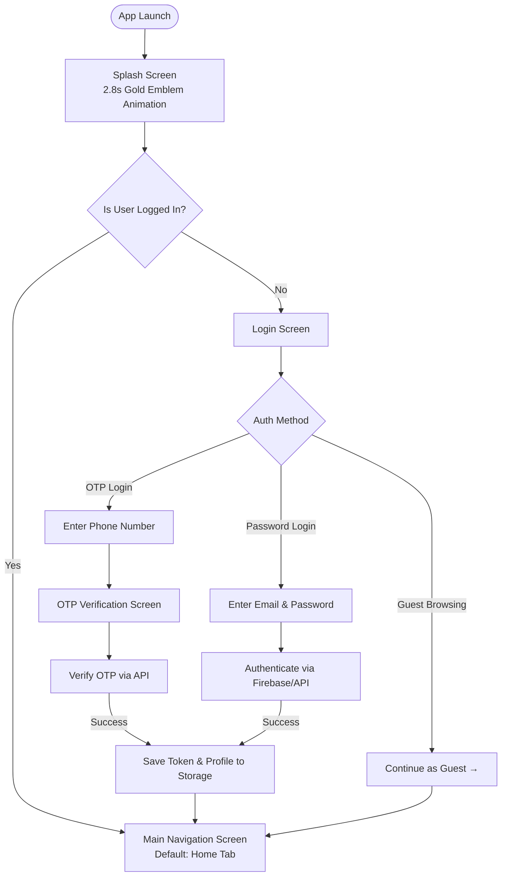

---

### 4.2 Marketplace Discovery & Search Flow

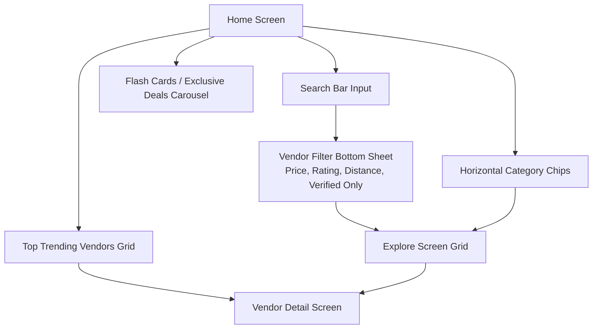

---

### 4.3 Vendor Selection & Booking Flow

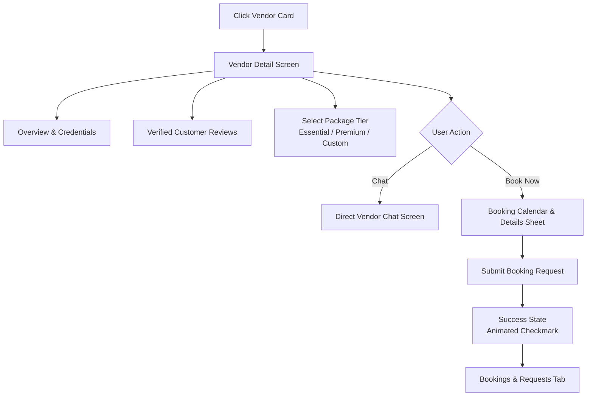

---

### 4.4 Vendor Communication & Concierge Flow

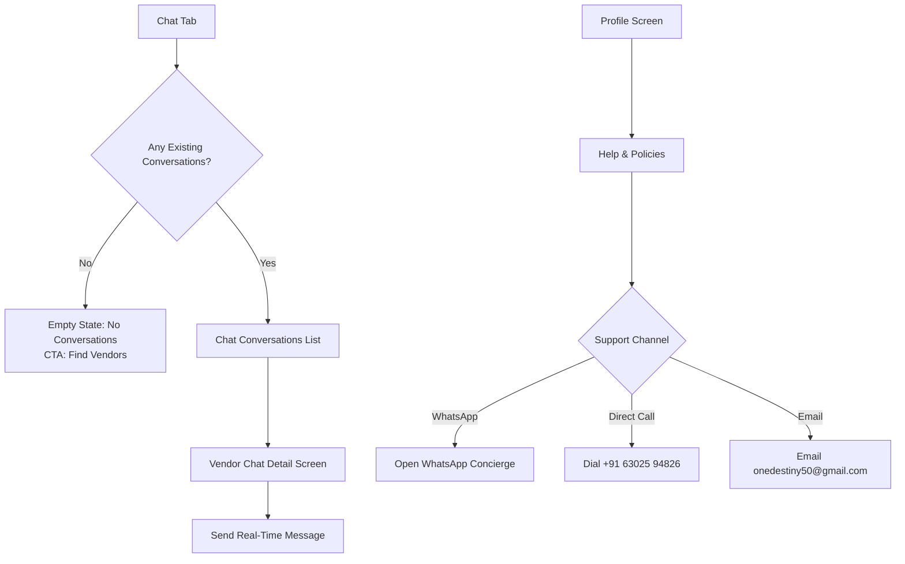

---

### 4.5 Profile, Sessions & Device Security Flow

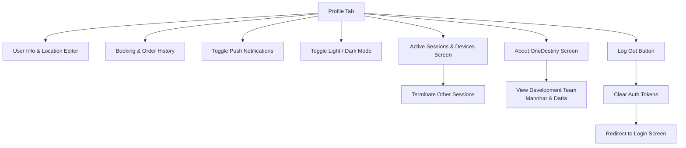

---

## 5. Screen-by-Screen Visual Walkthrough

### 5.1 Splash Screen (Brand Identity)

The application entry point presents a full-screen luxury brand reveal on Imperial Deep Burgundy (`#6B1028` to `#160207`). The 3D metallic gold emblem, center celebration star, and official tagline are smoothly antialiased with zero edge clipping across all device resolutions.

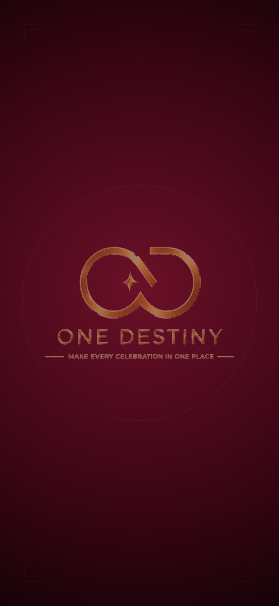

- **Components**:
  - Antialiased 3D Gold Logo Emblem (`assets/images/one_destiny_logo_transparent.png`)
  - Subtitle Tagline: `—— MAKE EVERY CELEBRATION IN ONE PLACE ——`
  - 2.8-second smooth scale and fade-in curve (`Curves.easeOutBack`)
  - Zero-latency tap-to-skip gesture for instant navigation

---

### 5.2 Authentication & Login (OTP & Password)

The customer authentication screen offers multi-modal access: OTP phone verification, password credentials, and an instant guest bypass.

| OTP Authentication | Password Tab | Form Validation Error |
|:---:|:---:|:---:|
| 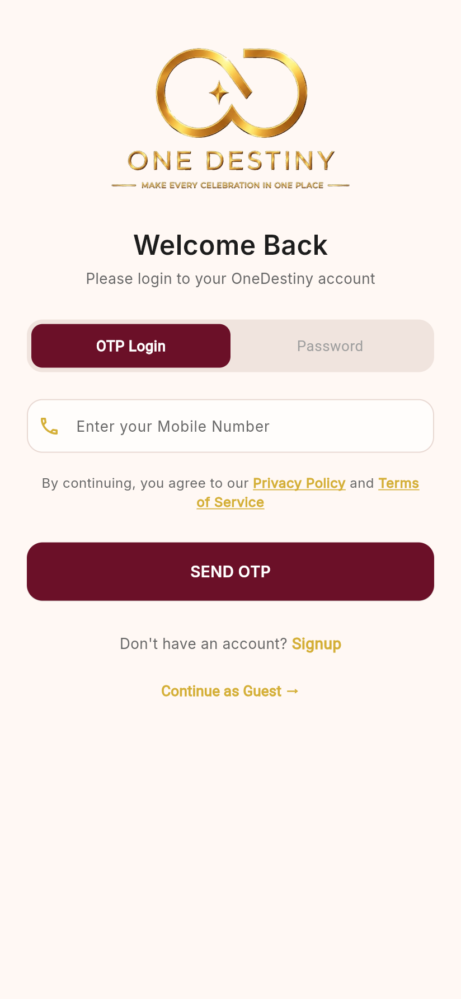 |  | 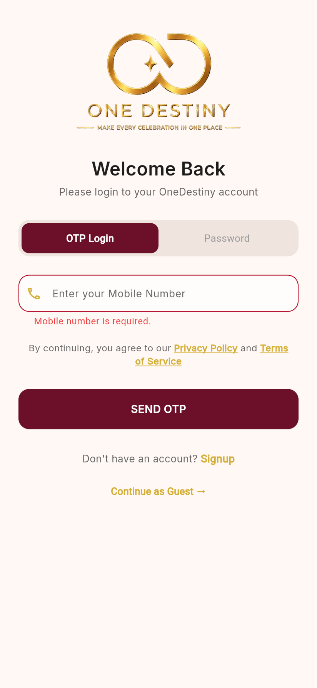 |

- **Components**:
  - Top header with official gold brand emblem and tagline
  - Tab switcher: `OTP Login` vs `Password`
  - Phone input field with country code support
  - Terms of Service & Privacy Policy deep links
  - Primary button: `SEND OTP`
  - Inline error feedback on empty or invalid inputs (`Canonical State 9`)
  - `Continue as Guest →` option for frictionless discovery

---

### 5.3 Marketplace Home Screen

The main customer landing hub features the Imperial Burgundy luxury header, current location selector, notification badge, theme toggle, and real-time vendor deals.

| Top View & Hero Header | Scrolled View (Top Vendors) |
|:---:|:---:|
| 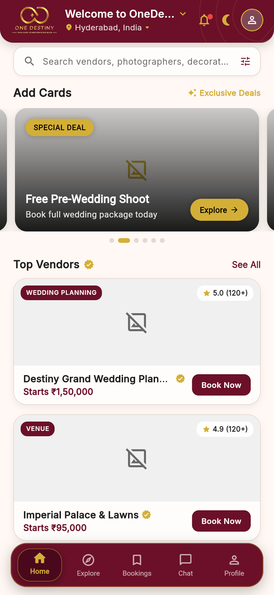 | 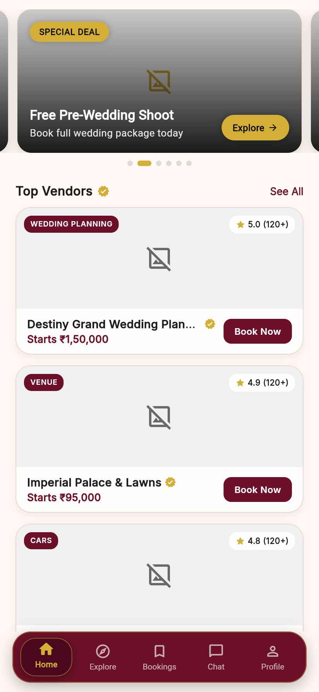 |

- **Components**:
  - **Luxury Header**:
    - Brand emblem lockup
    - Greeting & active location dropdown (`Hyderabad, India`)
    - Notification bell with unread indicator
    - Light / Dark mode toggle switch
    - User avatar
  - **Search & Filter Bar**: Instant debounce query input with modal filter trigger
  - **Exclusive Deals Carousel**: Dynamic promotional cards (`Special Deal: Free Pre-Wedding Shoot`)
  - **Top Vendors Grid**: Verified badge, star rating, verified review count, and direct `Book Now` CTA
  - **Persistent Floating Navigation Bar**: 5 primary tabs with active pill indicator

---

### 5.4 Explore Vendors Directory

The comprehensive discovery catalog allows customers to filter across thousands of service providers, venues, decorators, and entertainment specialists.

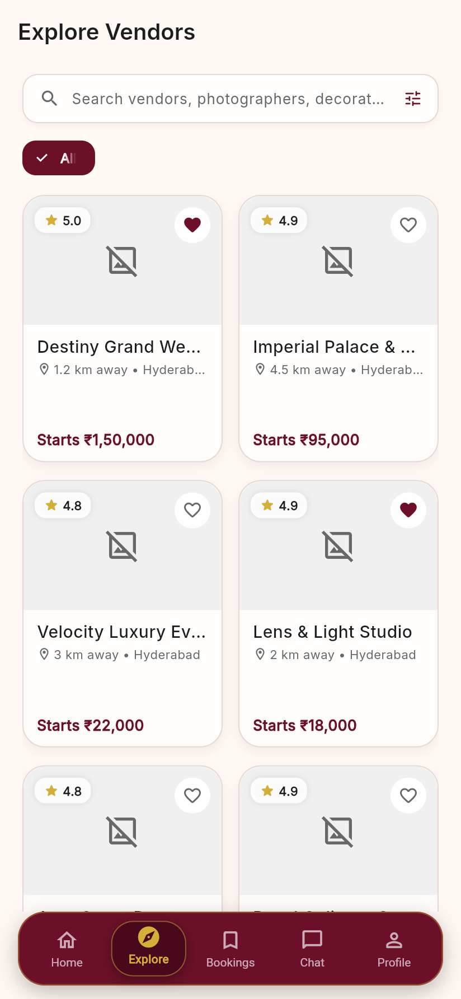

- **Components**:
  - Dedicated search bar with advanced filter sheet access
  - Horizontal scrolling category filter chips (`All`, `Venues`, `Photography`, `Decoration`, `Catering`, `Cars`)
  - 2-column responsive vendor card grid
  - Heart icon for one-tap favorite persistence
  - Starting package price indicators in INR (`₹`)
  - Distance calculation from user's current GPS location

---

### 5.5 Bookings & Event Requests Management

The centralized reservations dashboard allows customers to track pending inquiries, confirmed dates, and past celebration bookings.

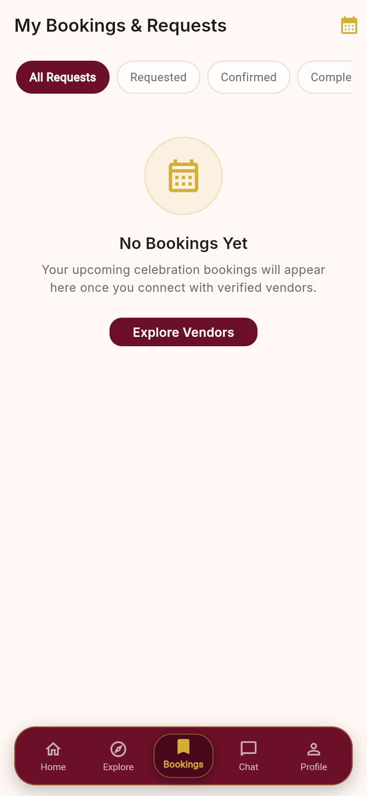

- **Components**:
  - Filter pills: `All Requests`, `Requested`, `Confirmed`, `Completed`
  - Top calendar icon quick access
  - **Canonical UI State 1A (Empty Bookings)**:
    - Gold celebration calendar illustration
    - Informative empty state copy: *"No Bookings Yet — Your upcoming celebration bookings will appear here once you connect with verified vendors."*
    - Direct CTA button: `Explore Vendors`

---

### 5.6 Real-Time Chat & Vendor Messaging

Direct messaging hub connecting customers with verified vendor managers for quotes, portfolios, and celebration date coordination.

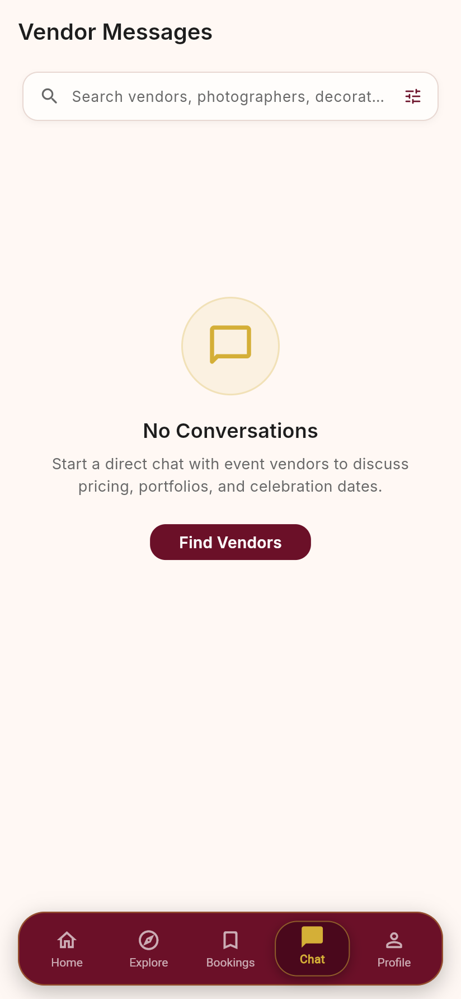

- **Components**:
  - Search bar to search conversations by vendor name
  - **Canonical UI State 1B (Empty Chats)**:
    - Soft gold chat bubble graphic
    - Explanation: *"No Conversations — Start a direct chat with event vendors to discuss pricing, portfolios, and celebration dates."*
    - Direct CTA button: `Find Vendors`

---

### 5.7 Customer Profile & Account Management

Complete user account center with profile editing, preferences, security, and concierge assistance.

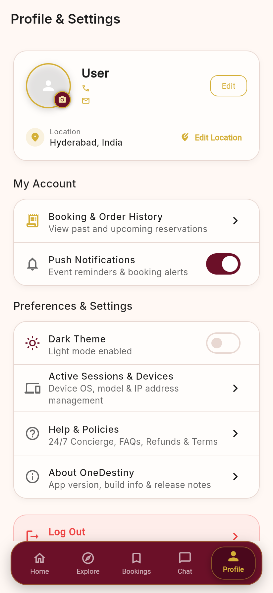

- **Components**:
  - Customer avatar card with photo update badge
  - Location badge with quick `Edit Location` sheet
  - **My Account**:
    - `Booking & Order History`
    - `Push Notifications` toggle switch
  - **Preferences & Settings**:
    - `Dark Theme` toggle switch
    - `Active Sessions & Devices` (Security)
    - `Help & Policies`
    - `About OneDestiny`
  - Highlighted red `Log Out` button with session cleanup

---

### 5.8 About OneDestiny & Development Team Credits

The official application information screen detailing release versioning, organization credentials, and development team attribution.

| About OneDestiny Screen | Development Team Section |
|:---:|:---:|
| 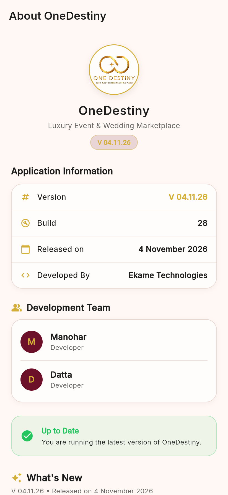 | 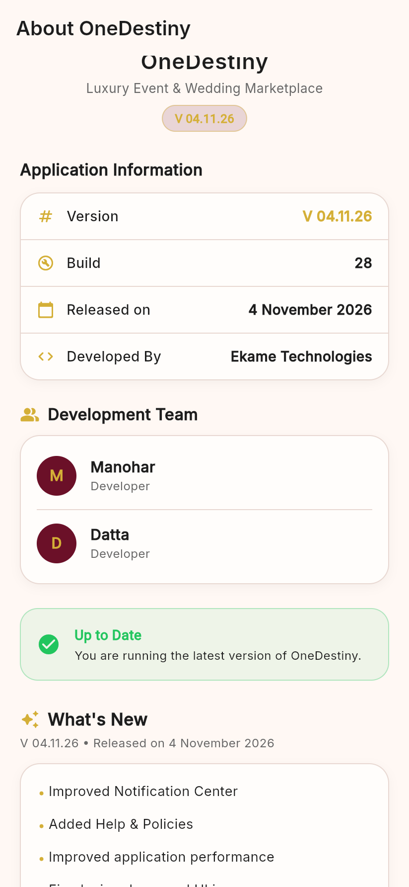 |

- **Components**:
  - Circular gold emblem brand hero
  - App Name: **OneDestiny**
  - Subtitle: *Luxury Event & Wedding Marketplace*
  - Version Pill: `V 04.11.26`
  - **Application Information**:
    - Version: `V 04.11.26`
    - Build: `28`
    - Released on: `4 November 2026`
    - Developed By: `Ekame Technologies`
  - **Development Team**:
    - **Manohar** — Developer (Avatar badge 'M')
    - **Datta** — Developer (Avatar badge 'D')
  - Verified `Up to Date` badge
  - Release changelog notes (`What's New`)

---

### 5.9 Vendor & Venue Detail Screen

Rich profile screen for individual vendors with image galleries, service overview, customer ratings, package tiers, and dual contact options.

| Vendor Overview & Stats | Packages & Booking CTAs |
|:---:|:---:|
| 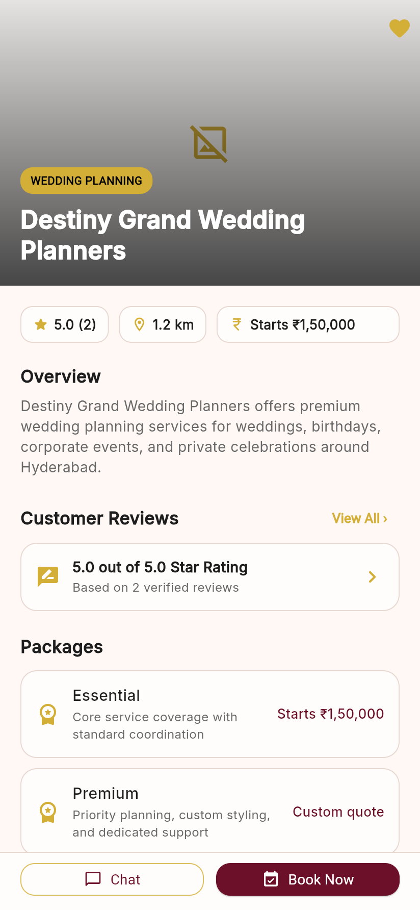 | 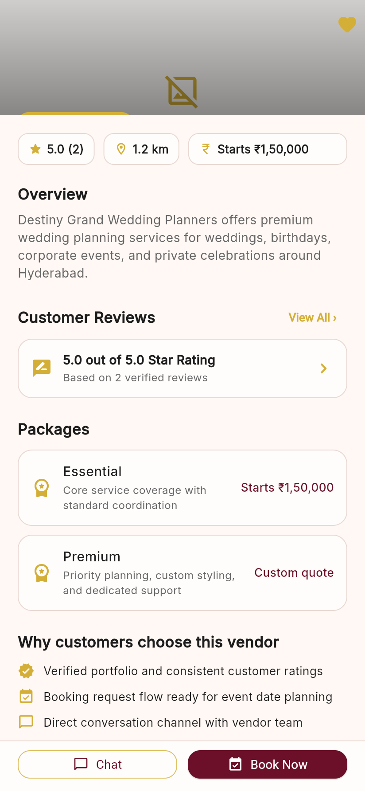 |

- **Components**:
  - Full-width hero gallery with category badge (`WEDDING PLANNING`)
  - Favorite heart toggle and back navigation
  - Metric chips: Star rating (`5.0 (2)`), Distance (`1.2 km`), Starting Price (`Starts ₹1,50,000`)
  - Detailed service overview prose
  - Customer Reviews preview card with star rating breakdown and `View All >` link
  - Package Tiers:
    - `Essential`: Core service coverage with standard coordination (Starts ₹1,50,000)
    - `Premium`: Priority planning, custom styling, and dedicated support (Custom quote)
  - Persistent bottom action bar:
    - `Chat` (Secondary outline button)
    - `Book Now` (Primary burgundy pill button with calendar icon)

---

### 5.10 Saved Favorites Collection

Customer's personal shortlist of favored vendors and venues for rapid comparison.

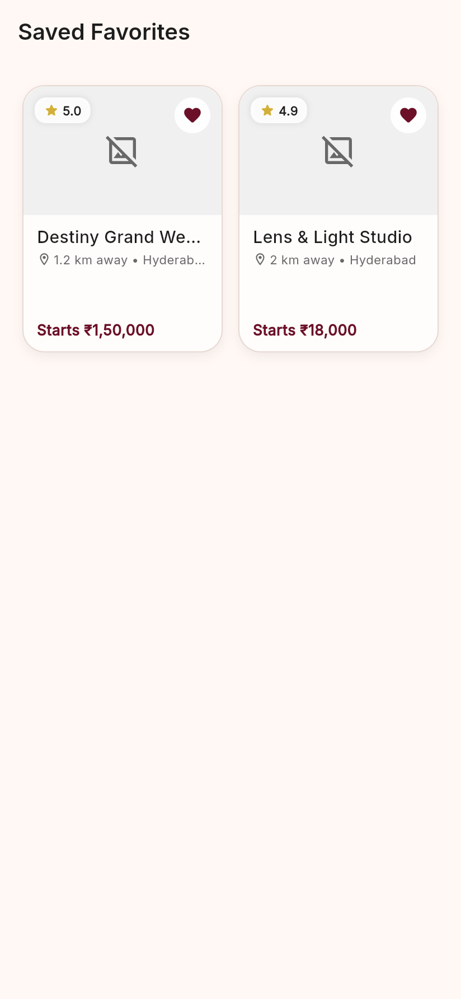

- **Components**:
  - Clean top app bar: `Saved Favorites`
  - Responsive 2-column card grid
  - Active filled burgundy heart icons for 1-tap removal
  - Direct tap to view full vendor profile
  - Empty state fallback (`EmptyStateWidget.noFavorites`) when list is cleared

---

### 5.11 24/7 Event Concierge & Help Policies

Comprehensive customer safety and support center with direct communication channels and payment advisories.

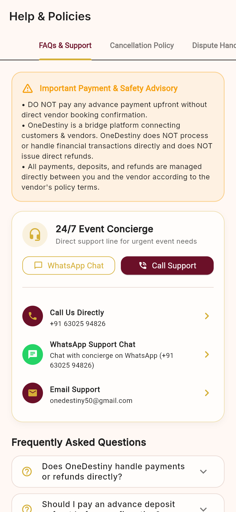

- **Components**:
  - Category tabs: `FAQs & Support`, `Cancellation Policy`, `Dispute Handling`
  - **Important Payment & Safety Advisory**:
    - Advisory against paying advance deposits without confirmed bookings
    - Platform role clarification as a marketplace bridge
  - **24/7 Event Concierge**:
    - `WhatsApp Chat` direct link
    - `Call Support` direct telephone dialer
  - Direct contact list:
    - Phone: `+91 63025 94826`
    - WhatsApp: `+91 63025 94826`
    - Email: `onedestiny50@gmail.com`
  - Expandable FAQ accordions addressing payment, advance deposits, and quotes

---

### 5.12 Dark Theme Experience

Full high-contrast dark theme optimized for OLED displays and evening planning sessions, utilizing Obsidian Black (`#121212`) and metallic Champagne Gold (`#D4AF37`).

| Dark Mode Home Screen | Dark Mode Explore Grid | Dark Mode About Screen |
|:---:|:---:|:---:|
| 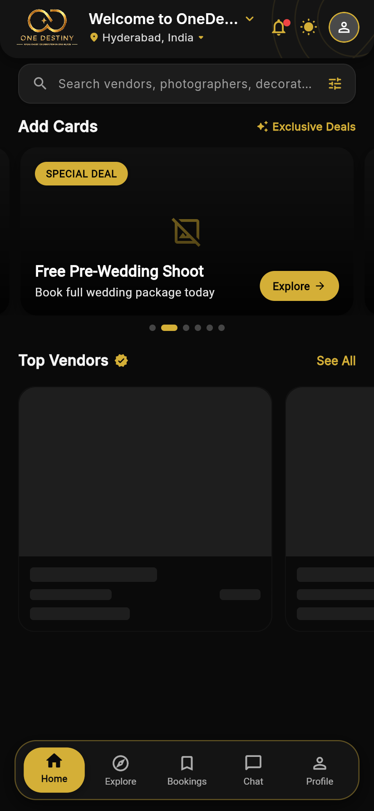 | 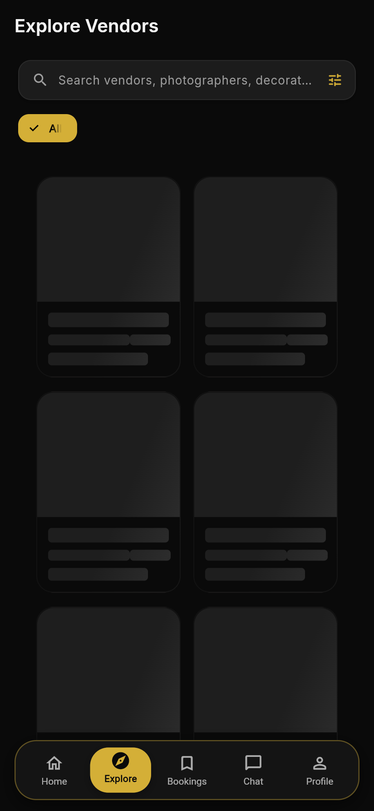 | 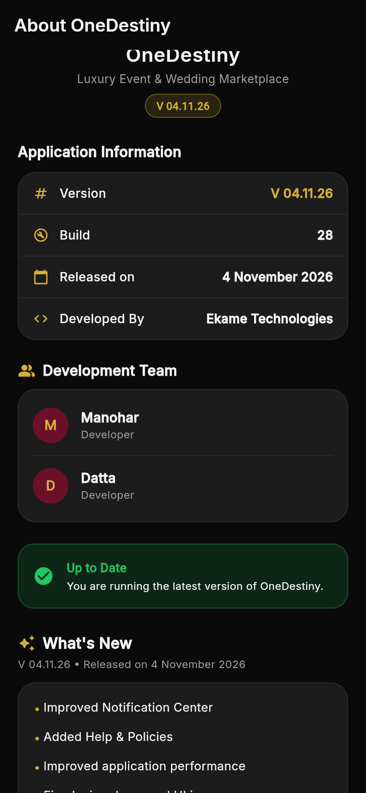 |

- **Highlights**:
  - High contrast readability adhering to WCAG AAA standards
  - Golden active bottom navigation indicator pill
  - Shimmer skeletons optimized with subtle charcoal pulse
  - Seamless system theme and in-app preference synchronization

---

## 6. Data Models & API Contracts

### App Version & Development Team (`assets/config/app_version.json`)
```json
{
  "version": "04.11.26",
  "build_number": 28,
  "release_date": "2026-11-04",
  "developer": "Ekame Technologies",
  "developers": [
    {
      "name": "Manohar",
      "role": "Developer",
      "url": ""
    },
    {
      "name": "Datta",
      "role": "Developer",
      "url": ""
    }
  ],
  "update_required": false
}
```

### Core Domain Entities
- **`VendorModel`**: Unique ID, business name, category, rating, reviews count, starting price, location coordinates, verified status, cover images, and packages list.
- **`BookingModel`**: Reservation ID, vendor reference, customer ID, celebration date, guest count, package tier, booking status (`requested`, `confirmed`, `completed`, `cancelled`), and payment notes.
- **`ChatMessageModel`**: Message ID, conversation ID, sender ID, recipient ID, message body, timestamp, read status, and attachment URLs.
- **`UserProfileModel`**: User ID, full name, email, mobile number, role, avatar URL, active city location, and notification preferences.

---

## 7. Verification & Build Commands

### Code Quality & Static Analysis
```bash
# Verify 0 analyzer issues across entire repository
flutter analyze
```

### Automated Test Suite
```bash
# Run all unit, widget, UI state, and integration tests
flutter test
```
*Current test suite passing: **25 / 25 tests** (`100% pass rate`).*

### Web Production Release Build
```bash
# Build optimized web application bundle
flutter build web --release --no-tree-shake-icons
```

---

*Document compiled and maintained by the OneDestiny Engineering Team (Ekame Technologies).*

